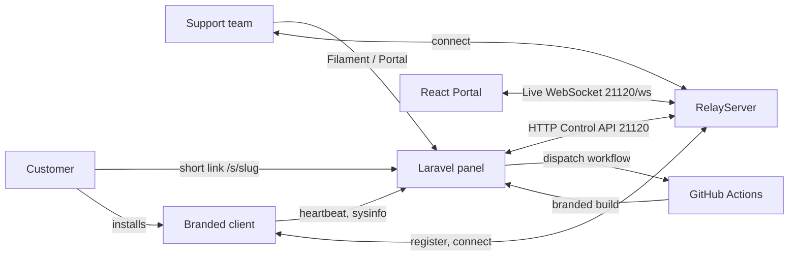

# SupportDesk

A self-hosted remote support platform. Support teams manage customers, brand a remote-desktop client for each
of them, hand out download links and connect to the customers' devices, all over their own relay infrastructure.

## Components

| Directory | What it is |
|-----------|-----------|
| `app/`, `routes/`, `database/`, `config/` | Laravel 13 backend with a Filament admin panel (`/admin`), `RelayBridgeService` real-time Rust bridge, and REST APIs. |
| `resources/portal/` | React single-page portal (`/portal`) with a live WebSocket device dashboard, brand settings, build manager, and short links. |
| `client/` | Branded remote-desktop client (Flutter + Rust, RustDesk based). Reads `brand.json` for the app name, servers and key. |
| `RelayServer/` | Single-binary Rust rendezvous, relay, and real-time control/WebSocket server (`21115-21120`). See [RelayServer/README.md](RelayServer/README.md). |
| `.github/workflows/` | CI that packages branded client builds on request from the panel. |

## How the pieces fit together



## Real-Time Laravel <-> Rust Bridge

`RelayServer` exposes a lightweight HTTP + WebSocket Control server on port `21120` (`src/controllers/control.rs`):

- **Live Event Stream (`WS /ws`)**: Every UDP peer registration (`peer.online`), peer expiration (`peer.offline`), block/unblock state change (`peer.blocked` / `peer.unblocked`), and active relay stream (`session.started` / `session.ended`) is broadcast over a `tokio::sync::broadcast` channel directly to connected WebSocket clients (`resources/portal/components/DeviceList.jsx`) with zero polling overhead.
- **Snapshot & Control Commands (`GET /status`, `POST /peers/{id}/{disconnect,block,unblock}`)**: Laravel's `App\Services\RelayBridgeService` queries live online peers, active relay sessions, and blocked IDs directly from `RelayServer` memory, and sends immediate disconnect/block/unblock commands that terminate active Rust relay tasks via a `tokio::sync::watch` cancellation channel.

1. A support team creates a customer and a client app (name, logo, unattended access) in the panel.
2. The panel dispatches a GitHub workflow that packages the client with a generated `brand.json`
   (rendezvous server, relay server, public key, API URL) and uploads the artifact back.
3. The customer opens a short link (`/s/{slug}`) and downloads the installer.
4. The installed client reports to the panel API (`/api/heartbeat`, `/api/sysinfo`) and registers with RelayServer,
   which brokers direct connections or relays the session.

## Quick start

### Panel

```bash
composer install
cp .env.example .env && php artisan key:generate
php artisan migrate --seed
npm install && npm run build
php artisan serve
```

Set `PANEL_RENDEZVOUS_SERVER`, `PANEL_RELAY_SERVER` and `PANEL_RELAY_KEY` in `.env` to your RelayServer host and the
contents of its `id_ed25519.pub`. GitHub build dispatch needs `PANEL_GITHUB_REPOSITORY` and `PANEL_GITHUB_TOKEN`.

### RelayServer

```bash
cd RelayServer
cargo build --release
RELAY_HOST=127.0.0.1 DATA_DIR=data ./target/release/relay-server
```

For production use Docker (`docker compose up -d --build`) or the Ubuntu installer
(`sudo ./deploy/install-ubuntu.sh <host>`). Details are in the [RelayServer README](RelayServer/README.md).

### Client

See `client/` for the upstream build documentation. Place the `brand.json` generated by the panel next to the
executable (or let the panel build and sign the package for you).
